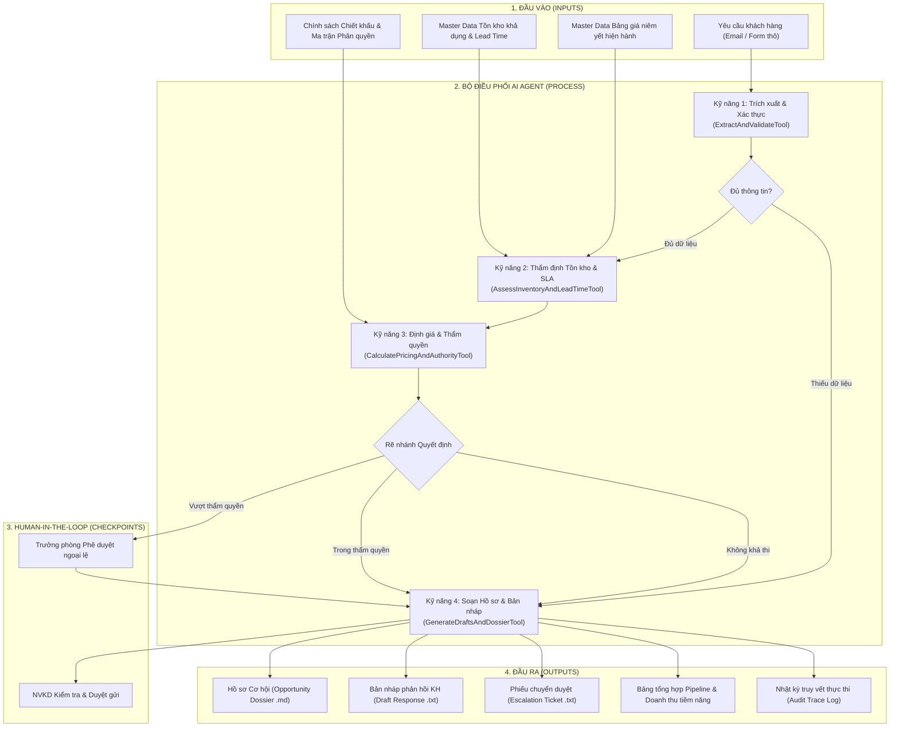

# BÁO CÁO THIẾT KẾ VÀ TRIỂN KHAI HỆ THỐNG AI AGENT XỬ LÝ CƠ HỘI BÁN HÀNG B2B
## HỌC PHẦN: AI301 | ĐỀ 01 | CÔNG TY MINH AN

---

## MỤC LỤC
1. [TASK 1: PHÂN TÍCH VÀ THIẾT KẾ QUY TRÌNH](#task-1-phân-tích-và-thiết-kế-quy-trình)
   - [1.1. Phân tích quy trình hiện tại](#11-phân-tích-quy-trình-hiện-tại)
   - [1.2. Xác định 3 vấn đề cốt lõi và ảnh hưởng cụ thể](#12-xác-định-3-vấn-đề-cốt-lõi-và-ảnh-hưởng-cụ-thể)
   - [1.3. Trình bày quy trình đề xuất](#13-trình-bày-quy-trình-đề-xuất)
   - [1.4. Lựa chọn 3 bước AI Agent tự thực hiện và lý do](#14-lựa-chọn-3-bước-ai-agent-tự-thực-hiện-và-lý-do)
   - [1.5. Xác định 2 điểm Human-in-the-Loop (HITL)](#15-xác-định-2-điểm-human-in-the-loop-hitl)
   - [1.6. Bản thiết kế hệ thống theo Mục tiêu – Đầu vào – Quy trình – Đầu ra](#16-bản-thiết-kế-hệ-thống-theo-mục-tiêu--đầu-vào--quy-trình--đầu-ra)
2. [TASK 2: XÂY DỰNG GIẢI PHÁP CHẠY ĐƯỢC & KẾT QUẢ KIỂM THỬ](#task-2-xây-dựng-giải-pháp-chạy-được--kết-quả-kiểm-thử)
   - [2.1. Kiến trúc giải pháp và các Kỹ năng nghiệp vụ](#21-kiến-trúc-giải-pháp-và-các-kỹ-năng-nghiệp-vụ)
   - [2.2. Bằng chứng thực thi: Tool Calling và Nhật ký truy vết (Audit Trace Log)](#22-bằng-chứng-thực-thi-tool-calling-và-nhật-ký-truy-vết-audit-trace-log)
   - [2.3. Quy tắc an toàn (Safety Guardrails)](#23-quy-tắc-an-toàn-safety-guardrails)
   - [2.4. Bảng tổng hợp số liệu và phân tích kết quả kiểm thử](#24-bảng-tổng-hợp-số-liệu-và-phân-tích-kết-quả-kiểm-thử)
   - [2.5. Hướng dẫn nạp dữ liệu thi trực tiếp](#25-hướng-dẫn-nạp-dữ-liệu-thi-trực-tiếp)

---

# TASK 1: PHÂN TÍCH VÀ THIẾT KẾ QUY TRÌNH

## 1.1. Phân tích quy trình hiện tại
Hiện tại, Công ty Minh An vận hành việc tiếp nhận và xử lý cơ hội bán hàng B2B hoàn toàn theo phương thức thủ công (manual process) qua các bước sau:
1. **Tiếp nhận yêu cầu:** Mỗi tuần, 6 Nhân viên Kinh doanh (NVKD) tiếp nhận khoảng 180 yêu cầu từ email và biểu mẫu web (trung bình 30 yêu cầu/nhân viên/tuần).
2. **Đọc hiểu & Làm rõ thông tin:** NVKD đọc từng văn bản yêu cầu của khách hàng, tự lọc sản phẩm, số lượng, thời hạn, ngân sách và chiết khấu mong muốn. Nếu thấy thiếu thông tin, NVKD tự soạn email/gọi điện hỏi lại khách hàng.
3. **Tra cứu bảng giá & Thẩm định khả năng cung ứng:** NVKD mở file bảng giá thủ công (thường lưu cục bộ hoặc trên bảng tính Excel) để tra cứu giá niêm yết; sau đó nhắn tin hoặc gửi email sang bộ phận Vận hành/Kho vận để hỏi tồn kho khả dụng và thời gian nhập hàng (Lead time).
4. **Lập đề xuất & Xin duyệt:** NVKD tự tính toán mức chiết khấu đề xuất và lập bản báo giá/dự thảo. Nếu yêu cầu có chiết khấu cao hoặc vượt quyền hạn, NVKD chuyển tiếp qua email/chat cho Trưởng phòng Kinh doanh xin phê duyệt.
5. **Gửi khách hàng & Bàn giao:** Sau khi được duyệt (hoặc tự duyệt), NVKD gửi báo giá cho khách hàng và theo dõi phản hồi.

---

## 1.2. Xác định 3 vấn đề cốt lõi và ảnh hưởng cụ thể

| STT | Vấn đề cốt lõi trong bối cảnh | Cơ chế phát sinh | Ảnh hưởng cụ thể đến doanh nghiệp |
|---|---|---|---|
| **1** | **Bỏ sót hạng mục, dùng giá cũ lỗi thời và cam kết sai thời hạn triển khai** | NVKD xử lý nhiều văn bản phi cấu trúc, tra cứu bảng giá thủ công từ các file Excel cũ, không đồng bộ dữ liệu thời gian thực với bộ phận Kho vận. | - **Rủi ro tài chính:** Báo giá thấp hơn giá vốn hoặc áp dụng giá cũ gây thiệt hại lợi nhuận trực tiếp.<br>- **Vi phạm cam kết SLA:** Hứa giao hàng trong 3 ngày trong khi kho hết hàng và cần 14 ngày nhập khẩu dẫn đến phạt hợp đồng và hủy đơn.<br>- **Mất uy tín thương hiệu:** Đề xuất bỏ sót linh kiện/dịch vụ đi kèm khiến khách hàng đánh giá công ty thiếu chuyên nghiệp. |
| **2** | **Yêu cầu thiếu ngân sách/người duyệt bị chuyển qua lại, đùn đẩy và mất dấu (Drop lead)** | Không có quy định phân luồng tự động; khi khách hàng chưa ghi rõ ngân sách hoặc yêu cầu cần sếp duyệt, NVKD có xu hướng chần chừ, chuyển việc cho người khác mà không có cơ chế gán người sở hữu (Ownership tracking). | - **Mất cơ hội doanh thu:** Yêu cầu bị "ngâm" quá lâu (48-72 giờ), khách hàng B2B chuyển sang mua của đối thủ cạnh tranh.<br>- **Tắc nghẽn quy trình:** Không có người chịu trách nhiệm chính khiến Trưởng phòng không kiểm soát được phễu bán hàng (Sales Pipeline).<br>- **Trải nghiệm khách hàng tệ:** Khách hàng không nhận được phản hồi xác nhận hoặc bị nhiều người liên hệ lặp đi lặp lại. |
| **3** | **Quá tải vận hành trên 6 NVKD và lãng phí thời gian vào tác vụ hành chính thủ công** | Khối lượng 180 yêu cầu phức tạp/tuần trên 6 NVKD đòi hỏi quá nhiều thao tác sao chép dữ liệu, tính toán phần trăm, liên hệ nội bộ hỏi kho và xin chữ ký duyệt. | - **Năng suất thấp:** NVKD dành tới 60-70% thời gian cho công việc giấy tờ thay vì tập trung tư vấn chuyên sâu và chốt hợp đồng lớn.<br>- **Độ trễ phản hồi (Lead Response Time) cao:** Thời gian từ lúc nhận lead đến lúc phát hành báo giá kéo dài từ 2-4 ngày làm việc.<br>- **Thiếu dữ liệu phân tích:** Ban Giám đốc không có báo cáo tổng hợp theo thời gian thực về tỷ lệ thành công, lý do từ chối và tổng giá trị cơ hội tiềm năng. |

---

## 1.3. Trình bày quy trình đề xuất
Bám sát theo sơ đồ thực tế của Công ty Minh An (*QUY TRÌNH XỬ LÝ CƠ HỘI BÁN HÀNG B2B - MINH AN COMPANY*), quy trình chuẩn hóa gồm 7 bước với ma trận trách nhiệm RACI như sau:

```
[Bắt đầu: Tiếp nhận yêu cầu] 
          │
          ▼
[Phân loại & Kiểm tra thông tin] ──► (Đủ thông tin?)
          │                                  │
      (Có)│                              (Không)
          ▼                                  ▼
[Tạo Hồ sơ Cơ hội & Gắn người phụ trách]  [Yêu cầu KH làm rõ/bổ sung] ──► (Quay lại Bắt đầu)
          │
          ▼
[Thẩm định tồn kho & giá] (Đối chiếu Master Data Vận hành & Bảng giá)
          │
          ▼
[Lập Báo giá & Dự thảo đề xuất]
          │
          ▼
(Có vượt thẩm quyền / Cần chiết khấu đặc biệt?)
          ├── (Có) ──► [Trưởng phòng duyệt] ──┐
          │                                   │
        (Không)                               │
          │                                   │
          ▼                                   ▼
   [Kết thúc: Cập nhật & Theo dõi Pipeline Bán hàng]
```

### Bảng đặc tả chi tiết quy trình:

| Bước | Tên bước | Đầu vào (Input) | Nội dung công việc (Tasks) | Đầu ra (Output) | Trách nhiệm (RACI) |
|---|---|---|---|---|---|
| **B1** | **Tiếp nhận yêu cầu** | Email khách hàng hoặc dữ liệu Form web | Thu thập nội dung văn bản, cấp mã định danh `inquiry_id`, ghi nhận thời điểm tiếp nhận. | Dữ liệu thô của yêu cầu | **AI Agent** (R)<br>NVKD (I) |
| **B2** | **Phân loại & Kiểm tra thông tin** | Dữ liệu văn bản thô | Phân tích cú pháp, trích xuất 5 trường bắt buộc: Tên KH, Email, Danh mục & SL sản phẩm, Ngân sách dự kiến, Thời hạn triển khai. | Trạng thái: ĐỦ / THIẾU và danh sách trường thiếu | **AI Agent** (R)<br>NVKD (A) |
| **B2.1** | **Yêu cầu KH làm rõ/bổ sung** | Danh sách các trường thông tin còn thiếu | Tự động tạo bản nháp email lịch sự nêu rõ thông tin cần bổ sung; NVKD review và gửi khách. | Email yêu cầu làm rõ gửi khách hàng | **AI Agent** (R)<br>NVKD (A) |
| **B3** | **Tạo Hồ sơ Cơ hội & Gắn người phụ trách** | Yêu cầu hợp lệ đủ thông tin | Khởi tạo Hồ sơ cơ hội (`Opportunity Dossier`), áp dụng thuật toán chia đều (Round-robin) gán 1 trong 6 NVKD chịu trách nhiệm theo dõi. | Hồ sơ cơ hội sơ bộ + NVKD phụ trách cố định | **AI Agent** (R)<br>NVKD (A) |
| **B4** | **Thẩm định tồn kho & giá** | Danh mục sản phẩm yêu cầu, thời hạn triển khai | Tự động tra cứu Master Data tồn kho khả dụng, tính lead time giao hàng; tra cứu bảng giá niêm yết hiện hành, đối chiếu SLA tiến độ. | Kết quả thẩm định tồn kho & khả năng đáp ứng thời hạn | **AI Agent** (R)<br>Vận hành (C)<br>NVKD (A) |
| **B5** | **Lập Báo giá & Dự thảo đề xuất** | Kết quả thẩm định kho, ngân sách khách, % chiết khấu yêu cầu | Tính tổng tiền niêm yết, chiết khấu theo quy mô, kiểm tra trần chiết khấu NVKD (10%) và trần giá trị đơn hàng (200M VND), soạn bản nháp báo giá. | Bản nháp báo giá chính thức hoặc Dự thảo chờ duyệt | **AI Agent** (R)<br>NVKD (A) |
| **B6** | **Trưởng phòng duyệt (nếu vượt quyền)** | Phiếu chuyển duyệt (Escalation Ticket) + Dự thảo đề xuất | Trưởng phòng xem xét căn cứ: chiết khấu > 10%, giá trị > 200M hoặc yêu cầu giao gấp; ra quyết định Phê duyệt / Từ chối / Điều chỉnh. | Quyết định phê duyệt chính thức | **Trưởng phòng** (A, R)<br>AI Agent (S)<br>NVKD (I) |
| **B7** | **Cập nhật & Theo dõi** | Kết quả báo giá/duyệt | NVKD kiểm tra lần cuối, gửi phản hồi cho khách; hệ thống cập nhật trạng thái pipeline (Ready/Need Info/Unfulfillable/Pending Approval) và lưu nhật ký. | Báo giá gửi KH + Bảng Dashboard tổng hợp | **NVKD** (R)<br>Trưởng phòng (I)<br>AI Agent (S) |

*(Ghi chú: R = Responsible - Thực hiện; A = Accountable - Chịu trách nhiệm cuối cùng; C = Consulted - Tham vấn; I = Informed - Nhận thông tin; S = Support - Hỗ trợ).*

---

## 1.4. Lựa chọn 3 bước AI Agent tự thực hiện và lý do

Nhóm lựa chọn **3 cụm bước cốt lõi** để AI Agent thực hiện tự động hoàn toàn:

### Bước 1: Tiếp nhận, Phân loại & Kiểm tra thông tin (B1 & B2)
- **Công việc AI thực hiện:** Tự động đọc văn bản tự nhiên từ email/form, trích xuất thực thể có cấu trúc (Entity Extraction: Khách hàng, Sản phẩm, Số lượng, Ngân sách, Deadline, Chiết khấu). Kiểm tra tính đầy đủ theo 5 tiêu chí thiết yếu. Nếu thiếu, tự động tạo bản nháp email phản hồi đề nghị bổ sung.
- **Lý do lựa chọn:**
  - *Tốc độ phản hồi tức thì:* Xử lý trong vòng 1-2 giây thay vì mất 15-30 phút đọc thủ công từng email.
  - *Chống đùn đẩy và mất dấu:* Ngay khi phát hiện thiếu ngân sách hoặc thiếu hạn giao, Agent tự động gán NVKD phụ trách và tạo sẵn email nháp, chấm dứt tình trạng yêu cầu bị bỏ quên.

### Bước 2: Thẩm định tồn kho khả dụng & Tính toán giá/chiết khấu theo chính sách (B4 & B5)
- **Công việc AI thực hiện:** Gọi các công cụ (Tool Calling) để truy vấn Master Data tồn kho thời gian thực; tính toán Lead time giao hàng chuẩn xác; áp dụng bảng giá niêm yết hiện hành và ma trận chiết khấu theo quy mô đơn hàng; kiểm tra ngân sách khách hàng.
- **Lý do lựa chọn:**
  - *Triệt tiêu sai sót:* Loại bỏ 100% lỗi dùng bảng giá cũ và lỗi hứa thời hạn giao hàng không khả thi.
  - *Giải phóng tắc nghẽn liên phòng ban:* NVKD không cần nhắn tin/gọi điện hỏi bộ phận Kho vận, vì Agent trực tiếp đối chiếu dữ liệu tồn kho khả dụng và thời gian restock.

### Bước 3: Tạo Hồ sơ Cơ hội, Soạn bản nháp phản hồi & Lập Phiếu chuyển duyệt (B5 & B6)
- **Công việc AI thực hiện:** Tổng hợp toàn bộ dữ kiện thành Hồ sơ cơ hội (`Opportunity Dossier`); tự động cá nhân hóa Bản nháp phản hồi khách hàng theo từng kịch bản; nếu phát hiện vượt quyền (chiết khấu > 10% hoặc đơn hàng > 200M VND), Agent tự tạo Phiếu chuyển duyệt (`Escalation Ticket`) trình bày đầy đủ căn cứ tài chính và rủi ro cho Trưởng phòng.
- **Lý do lựa chọn:**
  - *Tiết kiệm 80% thời gian văn phòng:* NVKD không phải soạn thảo văn bản từ đầu, chỉ cần đọc duyệt nhanh.
  - *Minh bạch và chuẩn hóa thẩm quyền:* Đảm bảo không có trường hợp vượt quyền nào bị lọt lưới; lãnh đạo có đầy đủ số liệu đối chiếu để ra quyết định chỉ trong vài giây.

---

## 1.5. Xác định 2 điểm Human-in-the-Loop (HITL)

Theo nguyên tắc an toàn, AI Agent đóng vai trò trợ lý hỗ trợ (Copilot/Enabler), quyền quyết định và gửi tài liệu chính thức ra bên ngoài thuộc về con người:

### Điểm kiểm tra 1: NVKD rà soát và phê duyệt Bản nháp phản hồi khách hàng
- **Vị trí trong quy trình:** Cuối bước B2.1 (gửi email xin bổ sung) và cuối bước B5/B7 (phát hành báo giá chính thức).
- **Điều kiện chuyển xử lý:** Khi AI Agent đã hoàn tất việc trích xuất, thẩm định tồn kho, tính giá và xuất ra file Bản nháp phản hồi khách hàng (`draft_response_*.txt`).
- **Nhiệm vụ của NVKD:** Đọc lại email nháp, kiểm tra tính phù hợp về mặt ngữ cảnh phi cấu trúc (ví dụ: mối quan hệ thân thiết với đối tác, ghi chú đặc thù, văn phong giao tiếp), chỉnh sửa nếu cần và bấm nút xác nhận gửi.
- **Cách phát hiện kết quả sai:**
  - So sánh yêu cầu gốc của khách với các hạng mục Agent trích xuất (phát hiện trường hợp tên linh kiện viết tắt lạ mà AI hiểu nhầm).
  - Kiểm tra xem thời hạn giao hàng cam kết có xung đột với các thỏa thuận miệng hay lịch bảo trì đặc biệt không.

### Điểm quyết định 2: Trưởng phòng Kinh doanh phê duyệt ngoại lệ / vượt thẩm quyền
- **Vị trí trong quy trình:** Bước B6 (khi điều kiện rẽ nhánh vượt thẩm quyền được kích hoạt).
- **Điều kiện chuyển xử lý:** Khi AI Agent phát hiện một trong các tiêu chí:
  1. Chiết khấu khách yêu cầu vượt khung tiêu chuẩn theo quy mô đơn hàng.
  2. Mức chiết khấu vượt quá 10% (hạn mức tối đa của NVKD).
  3. Tổng giá trị đơn hàng vượt quá 200,000,000 VND.
  4. Khách hàng yêu cầu giao hàng gấp hơn Lead time tiêu chuẩn của kho vận.
- **Nhiệm vụ của Trưởng phòng:** Mở Phiếu chuyển duyệt (`approval_ticket_*.txt`) do Agent lập sẵn, xem xét biên lợi nhuận gộp, phân tích tính chiến lược của khách hàng và ra quyết định: Duyệt / Từ chối / Đàm phán lại.
- **Cách phát hiện kết quả sai:**
  - Agent tự động hiển thị bảng so sánh: Giá niêm yết vs Giá sau chiết khấu vs Giá sàn tối thiểu (15% chiết khấu tối đa của công ty).
  - Cảnh báo cờ đỏ (Red Flag) nếu ngân sách khách hàng thấp hơn giá sàn hoặc khách hàng có lịch sử nợ xấu.

---

## 1.6. Bản thiết kế hệ thống theo Mục tiêu – Đầu vào – Quy trình – Đầu ra



### Chi tiết 4 thành phần thiết kế:
1. **Mục tiêu (Objectives):**
   - Tự động hóa 100% việc sàng lọc, tính giá, kiểm tra tồn kho và phân loại cho 180 yêu cầu/tuần.
   - Giảm thời gian phản hồi ban đầu từ 2-4 ngày xuống **dưới 5 phút**.
   - Loại bỏ hoàn toàn lỗi dùng giá cũ, hứa sai tiến độ kho và tính sai chiết khấu.
   - Tự động phân công trách nhiệm rõ ràng cho 6 NVKD và phân luồng sếp duyệt chuẩn mực.
2. **Đầu vào (Inputs):**
   - Yêu cầu khách hàng: Dạng văn bản phi cấu trúc (email/form).
   - Master Data Sản phẩm & Bảng giá: Mã SP, Tên SP, Đơn giá niêm yết hiện hành.
   - Master Data Kho vận: Tồn kho khả dụng, Lead time giao hàng có sẵn, Lead time đặt hàng.
   - Chính sách kinh doanh: Bậc thang chiết khấu, hạn mức NVKD (10%, 200M VND), hạn mức Quản lý (15%).
3. **Quy trình (Process):**
   - Agentic Workflow tuần tự phối hợp 4 kỹ năng nghiệp vụ độc lập (Modular Tools) với cơ chế suy luận ReAct (Thought - Action - Observation) và nhật ký truy vết Audit Trace Log.
4. **Đầu ra (Outputs):**
   - Hồ sơ cơ hội (`Opportunity Dossier` chuẩn Markdown).
   - Bản nháp phản hồi khách hàng (`Customer Draft Response` phân theo 4 kịch bản).
   - Phiếu chuyển duyệt (`Escalation Ticket` cho trường hợp vượt quyền).
   - Bảng tổng hợp số liệu Pipeline và tổng doanh thu tiềm năng theo thời gian thực.
   - Nhật ký truy vết đầy đủ bước suy luận, công cụ gọi và quy tắc áp dụng.

---

# TASK 2: XÂY DỰNG GIẢI PHÁP CHẠY ĐƯỢC & KẾT QUẢ KIỂM THỬ

## 2.1. Kiến trúc giải pháp và các Kỹ năng nghiệp vụ
Hệ thống được phát triển theo kiến trúc **Modular Agentic Workflow** với 4 Kỹ năng nghiệp vụ (Business Skills) độc lập:

1. **Kỹ năng 1: `ExtractAndValidateTool` (Trích xuất & Xác thực):**
   - Đọc văn bản thô, trích xuất cấu trúc dữ liệu JSON.
   - Đối chiếu với 5 trường bắt buộc (`customer_name`, `contact_email`, `items`, `budget`, `deadline_days`).
   - Kết luận yêu cầu là ĐẦY ĐỦ hay THIẾU DỮ LIỆU.
2. **Kỹ năng 2: `AssessInventoryAndLeadTimeTool` (Thẩm định Tồn kho & Tiến độ):**
   - Tra cứu Master Data tồn kho khả dụng hiện hành.
   - Nếu tồn kho đủ: $LeadTime = ReadyLeadTime$.
   - Nếu tồn kho thiếu: $LeadTime = RestockLeadTime$ (ghi rõ số lượng thiếu và thời gian chờ).
   - So sánh $LeadTime$ tối đa với thời hạn mong muốn của khách hàng để đánh giá khả thi.
3. **Kỹ năng 3: `CalculatePricingAndAuthorityTool` (Định giá & Thẩm quyền Chiết khấu):**
   - Tra cứu bảng giá niêm yết mới nhất (chống lỗi giá cũ).
   - Áp dụng ma trận chiết khấu theo quy mô giá trị đơn hàng.
   - Đánh giá thẩm quyền theo quy tắc:
     - Nếu $Chiết\_khấu \le 10\%$ VÀ $Tổng\_tiền \le 200,000,000\text{ VND}$ $\rightarrow$ NVKD tự quyết.
     - Nếu $Chiết\_khấu > 10\%$ HOẶC $Tổng\_tiền > 200,000,000\text{ VND}$ $\rightarrow$ Trưởng phòng duyệt.
   - Kiểm tra tương thích ngân sách khách hàng với giá sàn tối thiểu sau chiết khấu 15%.
4. **Kỹ năng 4: `GenerateDraftsAndDossierTool` (Lập Hồ sơ, Bản nháp & Phiếu duyệt):**
   - Tổng hợp toàn diện Hồ sơ Cơ hội.
   - Soạn thảo email phản hồi khách hàng chuyên nghiệp theo đúng ngữ cảnh.
   - Tạo phiếu duyệt gửi Trưởng phòng kèm đầy đủ luận cứ và đánh giá rủi ro tài chính.

---

## 2.2. Bằng chứng thực thi: Tool Calling và Nhật ký truy vết (Audit Trace Log)
Dưới đây là bằng chứng trích xuất từ các file log thực tế (`outputs/logs/`) được sinh ra tự động trong quá trình chạy, chứng minh Agent đọc dữ liệu, gọi công cụ cần thiết và suy luận logic thay vì nhập tay kết luận:

### Trích xuất Log 1: Trường hợp Thiếu thông tin ngân sách (REQ-002)
*(File nguồn: `outputs/logs/trace_REQ-002.txt`)*
```text
# NHẬT KÝ TRUY VẾT THỰC THI AGENT (AUDIT TRACE) - REQ-002
Thời gian thực thi: 2026-11-11 09:56:47
======================================================================
### BƯỚC 1: 1. Phân loại & Kiểm tra thông tin
- Thời gian: 2026-11-11 09:56:47
- Agent Thought (Suy luận): Agent tiếp nhận yêu cầu REQ-002 từ Tập đoàn Xây dựng An Thịnh. 
  Kiểm tra các trường bắt buộc theo chính sách công ty.
- Tool Called (Công cụ gọi): tool_extract_and_validate
- Tool Output: {"is_complete": false, "missing_fields": "Ngân sách dự kiến (budget)"}
- Quy tắc áp dụng: Chính sách kiểm tra 5 trường bắt buộc (Customer, Email, Items, Budget, Deadline)
- Quyết định: Yêu cầu THIẾU THÔNG TIN: Ngân sách dự kiến (budget). Rẽ nhánh: Gửi email yêu cầu KH làm rõ/bổ sung.
--------------------------------------------------
```

### Trích xuất Log 2: Trường hợp Vượt thẩm quyền chiết khấu (REQ-004)
*(File nguồn: `outputs/logs/trace_REQ-004.txt`)*
```text
# NHẬT KÝ TRUY VẾT THỰC THI AGENT (AUDIT TRACE) - REQ-004
Thời gian thực thi: 2026-11-11 09:55:53
======================================================================
### BƯỚC 1: 1. Phân loại & Kiểm tra thông tin
- Thời gian: 2026-11-11 09:55:53
- Agent Thought (Suy luận): Agent tiếp nhận yêu cầu REQ-004 từ Công ty Logistics Việt Vận.
- Tool Called: tool_extract_and_validate
- Tool Output: {"is_complete": true, "items_count": 2}
- Quyết định: Đủ thông tin. Chuyển sang bước Tạo Hồ sơ Cơ hội & Thẩm định tồn kho & giá.
--------------------------------------------------
### BƯỚC 2: 2. Thẩm định tồn kho & giá
- Thời gian: 2026-11-11 09:55:53
- Agent Thought (Suy luận): Thẩm định tồn kho và đối chiếu lead time, áp dụng chính sách chiết khấu và kiểm tra thẩm quyền.
- Tool Called: tool_assess_inventory_and_leadtime + tool_calculate_pricing_and_authority
- Tool Output: {"list_total": 161000000, "final_total": 141680000, "status": "Chờ duyệt", "requires_approval": true, "is_feasible": true}
- Quy tắc áp dụng: Bảng giá niêm yết hiện hành; Khung chiết khấu bậc thang; Ma trận thẩm quyền NVKD & Quản lý
- Quyết định: Yêu cầu khả thi nhưng vượt thẩm quyền NVKD (Chiết khấu yêu cầu (12%) vượt khung tiêu chuẩn theo quy mô đơn hàng (8%); Chiết khấu yêu cầu (12%) vượt hạn mức tối đa của NVKD (10%)). Chuyển Trưởng phòng duyệt.
--------------------------------------------------
```

---

## 2.3. Quy tắc an toàn (Safety Guardrails)
Hệ thống được lập trình với các rào chắn quy tắc nghiêm ngặt:
1. **Không tự động xác nhận bán hàng (Zero Unchecked Commitments):** Agent tuyệt đối không tự ý gửi email chốt đơn hoặc ký hợp đồng với khách hàng. Mọi đề xuất đều phải đi qua bước review của NVKD.
2. **Chặn bán hàng khi thiếu dữ liệu:** Khi yêu cầu thiếu ngân sách hoặc thời hạn, Agent không đoán mò giá trị, không đưa vào danh sách cơ hội tiếp tục mà lập tức chuyển sang trạng thái `Cần bổ sung thông tin`.
3. **Chặn vượt quyền thẩm quyền (Authority Enforcement):** Nếu chiết khấu vượt mức 10% hoặc giá trị đơn hàng vượt 200,000,000 VND, Agent bắt buộc tạo Phiếu chuyển duyệt (`Escalation Ticket`) và gán trạng thái `Chờ duyệt`, cấm NVKD tự ý phát hành báo giá.

---

## 2.4. Bảng tổng hợp số liệu và phân tích kết quả kiểm thử

Chương trình đã chạy tự động và kiểm thử thành công trên toàn bộ **7 kịch bản kiểm thử toàn diện** (Happy path, Thiếu thông tin, Ranh giới quy tắc, Không khả thi):

### BẢNG TỔNG HỢP CƠ HỘI BÁN HÀNG B2B (DASHBOARD METRICS):
*(Trích xuất từ: `outputs/summary_dashboard.md`)*

| Phân loại trạng thái | Số lượng cơ hội | Tỷ lệ (%) | Hành động tiếp theo |
|---|---|---|---|
| **Có thể tiếp tục (Qualified / Ready)** | **1** | 14.3% | NVKD kiểm tra bản nháp & phát hành báo giá |
| **Cần bổ sung thông tin (Need Info)** | **2** | 28.6% | Gửi email nháp đề nghị khách hàng làm rõ |
| **Chưa đáp ứng (Unfulfillable)** | **2** | 28.6% | Gửi email từ chối lịch sự & tư vấn giải pháp |
| **Chờ duyệt (Pending Approval)** | **2** | 28.6% | Chuyển phiếu duyệt Escalation Ticket cho Trưởng phòng |
| **TỔNG CỘNG** | **7** | 100% | Phân bổ đều giữa 6 NVKD theo cơ chế Round-robin |

### TỔNG GIÁ TRỊ CÁC CƠ HỘI ĐỦ ĐIỀU KIỆN TIẾP TỤC HOẶC CHỜ DUYỆT:
> $$\text{Tổng giá trị Pipeline Hợp lệ} = 117,760,000 + 141,680,000 + 255,750,000 = \mathbf{515,190,000\text{ VND}}$$

*(Lưu ý: Chỉ tính riêng các cơ hội đã vượt qua thẩm định khả thi về tồn kho, thời hạn và ngân sách, gồm cơ hội NVKD tự triển khai và cơ hội trình Trưởng phòng duyệt).*

---

### BẢNG KẾT QUẢ KIỂM THỬ CHI TIẾT TỪNG TRƯỜNG HỢP:

| Mã YC | Khách hàng | Loại kiểm thử | Trạng thái Agent kết luận | Giá trị đề xuất (VND) | NVKD phụ trách | Căn cứ và Quyết định xử lý |
|---|---|---|---|---|---|---|
| **REQ-001** | FPT Tech | Thông thường (Happy Path) | **Có thể tiếp tục** | 117,760,000 | Nguyễn Văn An | Đầy đủ dữ liệu, tồn kho đủ, giao 3 ngày < hạn 7 ngày, chiết khấu 8% trong khung tiêu chuẩn và $\le 10\%$, giá trị $< 200\text{M}$. NVKD tự phát hành báo giá. |
| **REQ-002** | An Thịnh Group | Thiếu dữ liệu (Missing Budget) | **Cần bổ sung thông tin** | - | Trần Thị Bình | Khách chưa khai báo ngân sách. Agent không tự bán, gán NVKD Bình và tạo bản nháp email xin bổ sung thông tin ngân sách. |
| **REQ-003** | Smart Edu | Thiếu dữ liệu (Missing Deadline) | **Cần bổ sung thông tin** | - | Lê Hoàng Cường | Khách chưa xác định thời hạn giao hàng. Agent gán NVKD Cường và tạo bản nháp email làm rõ tiến độ triển khai. |
| **REQ-004** | Logistics Việt Vận | Ranh giới (Chiết khấu 12% > 10%) | **Chờ duyệt** | 141,680,000 | Phạm Thu Dung | Hàng đủ, giao trong 2 ngày < 10 ngày. Khách xin chiết khấu 12% vượt hạn mức NVKD (10%). Agent tạo Phiếu chuyển duyệt gửi Trưởng phòng. |
| **REQ-005** | Đông Á Bank | Ranh giới (Deal size 275M > 200M) | **Chờ duyệt** | 255,750,000 | Vũ Minh Đức | Đủ hàng, lead time 3 ngày < 15 ngày, chiết khấu 7% hợp lệ. Tuy nhiên tổng giá trị niêm yết 275M vượt hạn mức 200M của NVKD. Chuyển Trưởng phòng duyệt. |
| **REQ-006** | VinaFashion | Chưa đáp ứng (Tồn kho & Deadline) | **Chưa đáp ứng** | - | Đặng Mai Phương | Cần 25 máy Dell giao trong 4 ngày. Kho chỉ có 20 máy (thiếu 5), thời gian nhập hàng cần 14 ngày. Agent tạo email thông báo từ chối và đề xuất lùi hạn. |
| **REQ-007** | EduBot Startup | Chưa đáp ứng (Ngân sách quá thấp) | **Chưa đáp ứng** | - | Nguyễn Văn An | Khách có ngân sách 70M, trong khi giá niêm yết là 103M. Ngay cả khi áp dụng chiết khấu tối đa 15% của Trưởng phòng thì giá vẫn là 87.55M > 70M. Agent từ chối lịch sự. |

---

## 2.5. Hướng dẫn nạp dữ liệu thi trực tiếp

Hệ thống được thiết kế hoàn toàn tách biệt giữa **Logic xử lý** và **Dữ liệu**. Tại buổi thi hoặc đánh giá thực hành, khi Giảng viên cung cấp một bộ dữ liệu mới (theo đúng cấu trúc JSON quy định), nhóm chỉ cần thực hiện 1 câu lệnh duy nhất:

### Chạy trực tiếp trên máy chấm thi (Windows PowerShell - Zero Dependency):
```powershell
# Chạy với tệp dữ liệu đề thi mới do Giảng viên cung cấp:
powershell -ExecutionPolicy Bypass -File .\run_agent.ps1 -DataPath "data\test_exam_sample.json"
```

### Hoặc chạy qua môi trường Python tiêu chuẩn:
```bash
python main.py data/test_exam_sample.json
```

**Kết quả kiểm thử thử nghiệm với bộ đề thi mẫu (`data/test_exam_sample.json`):**
- Xử lý 2 cơ hội mới:
  + `EXAM-001` (Y tế Hoàn Mỹ): Hợp lệ, giá trị 191,580,000 VND, trạng thái `Chờ duyệt` (do quy mô đơn hàng 206M > 200M).
  + `EXAM-002` (Viện Nông nghiệp): Trạng thái `Cần bổ sung thông tin` (thiếu ngân sách).
- Tổng giá trị đủ điều kiện: **191,580,000 VND**.
- Toàn bộ hồ sơ cơ hội, email nháp, phiếu chuyển duyệt và nhật ký truy vết được tự động cập nhật ngay lập tức vào thư mục `outputs/`.

